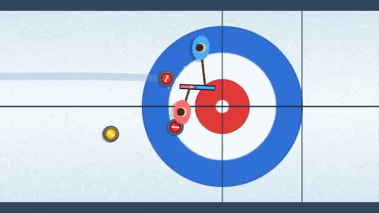

# Stone Slide

Slide it, then sweep like mad. Closest to the button scores. A multiplayer starter game from [Multiplayer Agent](https://multiplayeragent.com): 2D, versus, 2–8 players in two teams, with bots that fill empty seats.

## How it plays

Two teams take turns sliding stones down the ice at the target. Drag back to aim and set the weight, let go, then hold to sweep: the stone glides further and curls less. Four stones a team each end, three ends; your stones nearest the button score.

**Controls:** Drag back and let go to throw, hold to sweep (mouse or finger). The curl button picks which way the stone bends. Keys: arrows to aim and set the weight, Enter to throw, Space to sweep, C to change the curl.

## Make it yours in the Game Builder

Open the [Game Builder](https://multiplayeragent.com), choose **Start from a starter game** and pick Stone Slide. It opens as version 1 in your studio, ready to play and publish. Then ask for changes, for example:

- Add a power-up stone that knocks everything out of the house
- Make it an outdoor pond at night with snow falling
- Add a fourth end and a bigger house

## Run it yourself

1. Get a free publishable key (`pk_…`) at [multiplayeragent.com](https://multiplayeragent.com).
2. In `index.html`, put it in place of `pk_REPLACE_ME` in the `MP_CONNECT` block.
3. Open `index.html` in a browser. No build step and no server needed.

Without a key it still runs, offline against bots.

## How it is built

- One `index.html`. The comment at the top of the script maps the code and explains the multiplayer.
- **Leaderboard:** Most match wins, shown on the results card.
- **Host-run physics:** The host's browser slides every stone and counts each end; if it leaves, the next player takes over mid-slide.
- **Bots:** Bots throw and sweep on both teams until friends join.
- **Live sync:** Everyone sees each stone slide, the brooms sweep and the hits, all at once.
- `?attract` runs it offline with bots only. The preview video is recorded from it.

## License

MIT.
